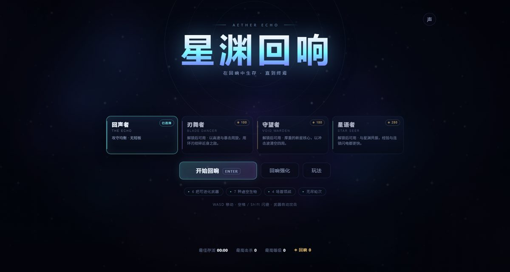

# 星渊回响 · AETHER ECHO

> 一款纯前端、零依赖的暗黑科幻 Roguelite 生存弹幕游戏。
> 画面全部由 Canvas 程序化绘制，音效与配乐全部由 WebAudio 实时合成——没有任何图片或音频素材文件。



## 快速开始

直接双击 `index.html` 开始游戏（Chrome / Edge / Firefox 均可，无需服务器与联网）。

若浏览器限制本地文件访问，在本目录执行：

```bash
python -m http.server 8080
```

打开 <http://127.0.0.1:8080>。

## 操作

| 操作 | 按键 |
|---|---|
| 移动 | `W` `A` `S` `D` / 方向键 |
| 闪避（无敌帧） | `空格` / `Shift` |
| 暂停 | `ESC` / `P` |
| 静音 | `M`（游戏中） |
| 选择强化 | 鼠标点击 / `1` `2` `3` |
| 重掷 | `R` |

触屏：左半屏虚拟摇杆，右下角「闪」按钮。

## 玩法

- 武器自动开火，玩家只负责走位、拾取经验与升级选择。
- 6 把武器各 8 级，升满立即进化为新形态；6 个武器位 + 6 个被动位。
- 10 种被动各 5 级，升级三选一，可重掷一次。
- 10 分钟一局：2:30 / 5:00 / 7:30 / 10:00 各一名首领，击破最终首领「终焉回响」通关。
- 通关后可进入无尽轮次；每局结束结算「回响」，用于永久强化与解锁角色。
- 自动存档（localStorage）。

### 六把武器

| 武器 | 定位 | 进化 |
|---|---|---|
| 星屑脉冲 | 自动锁敌高速弹 | 星屑风暴（穿透 + 追踪） |
| 轨道刃 | 环绕切割 | 永寂环带（六枚环刃） |
| 虚空新星 | 范围爆发 + 击退 | 奇点爆发（吸引 + 双重爆发） |
| 追猎蜂群 | 追踪爆炸弹 | 蜂群母巢 |
| 相位链 | 连锁闪电 | 雷暴回廊（连锁至九 + 眩晕） |
| 破碎明光 | 近距离散射 | 棱镜审判（弹射） |

### 四名角色

回声者（均衡）/ 刃舞者（高速暴击）/ 守望者（高血护甲）/ 星语者（经验与连锁），后三名用回响解锁。

### 四场首领战

织巢者（放射弹幕 + 虫群）、裂界兽（冲锋 + 冲击波）、千目（双目激光）、终焉回响（三阶段）。所有首领都有前摇；距离过远时会撕裂空间逼近，无法无限风筝。

## 技术实现

- 原生 Canvas 2D；预渲染星场 / 星云 / 辉光贴图，避免逐帧创建渐变。
- 固定步长 60Hz 累加器；切后台自动暂停。
- 网格空间哈希（96px）处理弹幕与敌群碰撞。
- 对象数量硬上限（敌人 260 / 弹幕 420 / 粒子 620）。
- 程序化音效 + 92 BPM 生成式配乐（四和弦循环，强度联动战斗密度）。
- 零依赖、零构建，约 4,000 行原生 JS。

```
index.html
css/style.css
js/
  data.js      全部数值表
  core.js      工具 / 输入 / 存档 / 摄像机
  audio.js     程序化音效与配乐
  fx.js        粒子 / 伤害数字 / 星场 / 屏幕效果
  player.js    玩家移动 / 闪避 / 属性
  weapons.js   六种武器开火逻辑
  enemies.js   敌群 AI 与四场 BOSS
  world.js     空间网格 / 弹幕 / 掉落
  ui.js        菜单 / 选卡 / 暂停 / 结算 / 强化
  game.js      主循环 / 波次导演 / 升级 / HUD
```

## 验证

开发过程中没有依赖手动点击：用 Node（Electron 内置运行时）+ DOM/Canvas 桩加载真实游戏代码做 10 分钟整局模拟与机器人自动选卡，统计等级 / 击杀 / BOSS / DPS 时间线；再用 Chrome DevTools Protocol 在真实浏览器里执行 25 项 UI 冒烟测试并截图。方法细节整理在笔记 `notes/toolbox/13-浏览器游戏的无头验证与平衡模拟.md`。

## 截图

| 战斗 | 升级选卡 |
|---|---|
|  |  |

| 首领战 | 结算 |
|---|---|
|  |  |

---

*版本 1.0.0 · 无外部素材 · 无第三方依赖*
