# 星渊回响 · AETHER ECHO

> 一款纯前端、零依赖的暗黑科幻 Roguelite 生存弹幕游戏。
> 全部画面由 Canvas 程序化绘制，全部音效与配乐由 WebAudio 实时合成——没有任何图片、音频素材文件。


---

## 立刻开始

**双击 `index.html`** 即可游玩（Chrome / Edge / Firefox 均可，无需服务器、无需联网、无需安装任何东西）。

如果浏览器限制本地文件（极少见），在该目录执行：

```bash
python -m http.server 8080
```

然后打开 <http://127.0.0.1:8080>。

---

## 操作

| 操作 | 按键 |
|---|---|
| 移动 | `W` `A` `S` `D` / 方向键 |
| 闪避（有无敌帧） | `空格` / `Shift` |
| 暂停 | `ESC` / `P` |
| 静音 | `M`（游戏中） |
| 选择强化 | 鼠标点击 / `1` `2` `3` |
| 重掷强化 | `R` |
| 每日挑战（菜单） | `D` |
| 首领连战（菜单） | `B` |

手机 / 平板：左半屏虚拟摇杆移动，右下角「闪」闪避，右上角「Ⅱ」暂停，武器自动瞄准；横竖屏都可玩，适配刘海安全区。

---

## 核心玩法

- **自动战斗**：武器自动锁定敌人开火，你只需要走位、拾取经验、在升级时做选择。
- **武器进化**：8 把武器各 8 级，升到 8 级立刻进化为全新形态（例如「星屑脉冲 → 星屑风暴」「引力奇点 → 事件视界」）。
- **构筑**：6 个武器位 + 6 个被动位，10 种被动各 5 级。8 把武器里只能带 6 把，取舍本身就是构筑。升级三选一，可重掷一次。
- **10 分钟一局**：2:30 / 5:00 / 7:30 / 10:00 各有一名首领，击破最终首领「终焉回响」即通关。
- **无尽轮次**：通关后可继续，敌人与首领全面强化。
- **首领连战**：不刷小怪，按顺序连打五名首领，每场之间三选一 ×3，按通关用时记录最佳。
- **遗物**：每次击破首领额外三选一遗物，14 件遗物能彻底改变同一套武器的玩法。
- **局外成长**：每局结束按表现结算「回响」，用于购买永久强化、解锁新角色。
- **图鉴 / 档案**：全部武器、被动、敌人、首领可查；16 项成就、生涯统计与本地最佳记录。
- **每日挑战**：每天一个固定种子，叠加 2 条随机扰动（敌人移速 / 伤害 / 经验 / 护甲等），单独记录今日最佳。
- **设置**：音乐 / 音效音量、屏幕震动、伤害数字、动态效果、高对比、画质，自动保存；持续掉帧会自动降一档画质。
- **自动存档**：进度保存在浏览器 localStorage。

### 八把武器

| 武器 | 定位 | 进化 |
|---|---|---|
| 星屑脉冲 | 自动锁敌高速弹 | 星屑风暴（穿透 + 追踪） |
| 轨道刃 | 环绕切割 | 永寂环带（六枚环刃） |
| 虚空新星 | 范围爆发 + 击退 | 奇点爆发（吸引 + 双重爆发） |
| 追猎蜂群 | 追踪爆炸弹 | 蜂群母巢（倾巢而出） |
| 相位链 | 连锁闪电 | 雷暴回廊（连锁至九 + 眩晕） |
| 破碎明光 | 近距离散射 | 棱镜审判（弹射） |
| 引力奇点 | 控场：持续牵引 + 范围伤害 | 事件视界（坍缩爆破） |
| 贯穿光矛 | 贯穿直线，清一列敌人 | 贯穿星轨（三道星轨） |

### 四名角色

回声者（均衡）/ 刃舞者（高速暴击）/ 守望者（高血护甲）/ 星语者（经验与连锁）。后三名用回响解锁。

### 五场首领战

- **织巢者**：放射弹幕 + 召唤虫群，暴走后开始螺旋编织。
- **裂界兽**：蓄力冲锋 + 环形冲击波，冲锋路径有虚线前摇。
- **千目**：保持距离，双目激光扫射 + 召唤喷吐者。
- **终焉回响**：三阶段，随机冲锋、螺旋弹幕、召唤重壳，越残血越狂暴。
- **星蚀**（无尽专属，13:00）：三颗黑星环绕本体、引力牵引玩家、三道旋转激光，血量 50% 后全面提速。

所有首领登场都有 **WARNING 演出卡**，攻击都有前摇/预警；距离拉得过远时会撕裂空间逼近，无法无限风筝。

### 每日挑战

每天用一个日期种子生成固定的一局，并叠加两条当日扰动：

| 扰动 | 效果 |
|---|---|
| 疾行之潮 | 敌人移速 +20%，经验 +15% |
| 狂暴低语 | 敌人伤害 +25%，回响 +20% |
| 丰饶裂隙 | 击杀经验 +35% |
| 虚空稀薄 | 敌人生命 -10%，数量 +20% |
| 铁壁回响 | 玩家护甲 +3，移速 -6% |

种子固定意味着同一天所有玩家的刷怪序列一致，可以互相比较；每日最佳按日期单独保存（最近 14 天）。

### 首领连战（Boss Rush）

- 不刷普通小怪，按「织巢者 → 裂界兽 → 千目 → 星蚀 → 终焉回响」顺序连打五名首领
- 开局自带 Lv3 主武器 + Lv2 副武器 + 两层强袭 + 一层生命
- 每击破一名首领恢复 30% 生命，并获得 **3 次升级选择**
- 首领血量按连战序号成长，不按时间成长，避免拖时间滚雪球
- 通关用时单独记录为「连战最佳」，结算页与档案页都能看到

### 遗物

每次击破首领后，先三选一获得一件遗物（14 件，本局永久生效），再进入升级选卡：

| 遗物 | 效果 |
|---|---|
| 狂怒核心 / 时律棱镜 | 伤害 +12% / 攻速 +10% |
| 血契 / 猩红契约 | 生命 +20% / 伤害 +22% 但生命 -10% |
| 猎杀本能 / 连锁暴击 | 暴击 +10% / 暴击时溅射 35% |
| 再生核心 / 吸血符文 | 每秒回复 1.2 / 击杀回复 1.5 |
| 引力透镜 / 巨力弹头 | 拾取 +40%、经验 +10% / 范围 +15% |
| 相位装甲 / 时之沙 | 护甲 +4 / 闪避冷却 -25% |
| 爆裂回响 / 霜冻之触 | 击杀 18% 爆炸 / 命中 12% 冻结 |

暂停界面会显示当前已获得的遗物图标。

---

## 技术实现

- **渲染**：原生 Canvas 2D，预渲染星场 / 星云 / 辉光贴图，避免逐帧创建渐变。
- **循环**：固定步长 60Hz 累加器 + 渲染插值；切后台自动暂停。
- **碰撞**：网格空间哈希（96px 单元），弹幕只查询邻近 9 格。
- **性能**：对象数量硬上限（敌人 260 / 弹幕 420 / 粒子 620），自适应清理。
- **音频**：程序化合成音效 + 92 BPM 生成式配乐（四和弦循环，强度联动战斗密度）。
- **零依赖**：没有 npm、没有构建步骤、没有外部资源，全部逻辑约 4,000 行原生 JS。

### 目录结构

```
aether-echo/
├─ index.html          入口
├─ css/style.css       界面样式
├─ js/
│  ├─ data.js          全部数值表（武器/被动/敌人/BOSS/角色/永久强化）
│  ├─ core.js          工具、输入、存档、摄像机
│  ├─ audio.js         程序化音效与生成式配乐
│  ├─ fx.js            粒子、伤害数字、星场、屏幕效果
│  ├─ player.js        玩家移动 / 闪避 / 属性 / 绘制
│  ├─ weapons.js       六种武器的开火逻辑与环刃判定
│  ├─ enemies.js       敌群 AI、七种族、四场 BOSS 战
│  ├─ world.js         空间网格、弹幕、经验球、掉落
│  ├─ ui.js            菜单 / 选卡 / 暂停 / 结算 / 强化界面
│  └─ game.js          主循环、波次导演、升级、HUD
├─ shots/              运行截图
└─ tools/              无头模拟器与自动化测试（开发用，可删）
```

---

## 开发与验证

这个项目在没有手动点击的情况下做了两轮自动化验证：

1. **Node 无头模拟器**（`tools/sim.cjs`）：在 Node 中加载真实游戏代码 + Canvas/DOM 桩，跑完整 10 分钟对局，机器人自动走位与选卡，输出等级 / 击杀 / BOSS / DPS 时间线，用于数值平衡。
2. **Chrome CDP 自动化**（`tools/selftest.html` + `tools/cdp-shot.cjs`）：真实浏览器中执行 51 项 UI 冒烟测试（菜单、开始、升级选卡、暂停、恢复、结算、强化购买、角色解锁、设置、高对比 / 低动态、图鉴、档案、成就、每日挑战种子与每日记录、首领登场、首领连战、遗物三选一），并抓取控制台异常；同时用 CDP 截图做视觉回归，包括 430×900 的手机竖屏。

运行方式（本机 Electron 内置 Node）：

```bash
# 语法检查
<electron> tools/check.cjs

# 数值模拟：标签 局数 最长秒数 起始种子 [god]
<electron> tools/sim.cjs demo 4 700 1

# 截图（需要 Chrome）
<electron> tools/cdp-shot.cjs file:///.../index.html shots/menu.png 3000 -
```

调整数值只需要改 `js/data.js`，无需改动逻辑代码。

---

## 截图

| 战斗 | 升级选卡 |
|---|---|
|  | 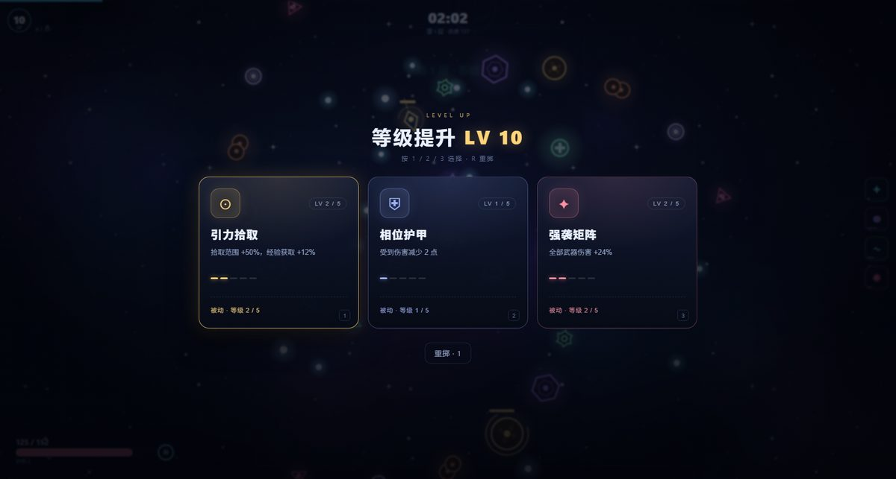 |

| 首领战 | 结算 |
|---|---|
| 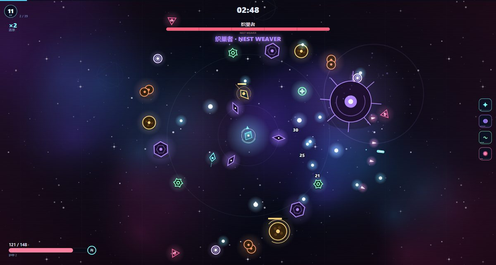 | 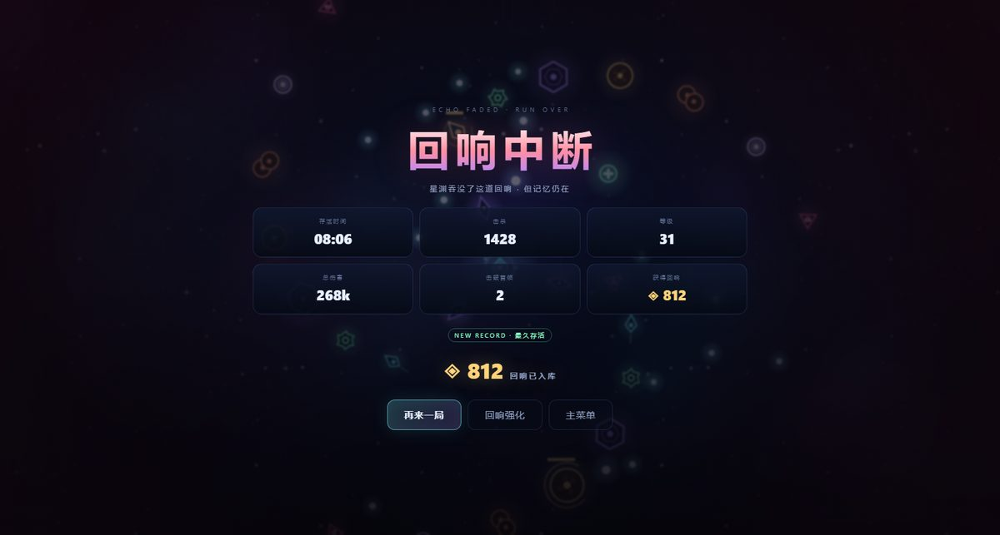 |

| 图鉴 | 档案 |
|---|---|
| 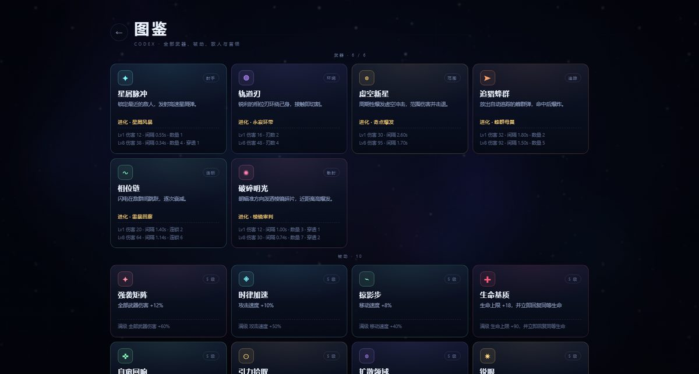 | 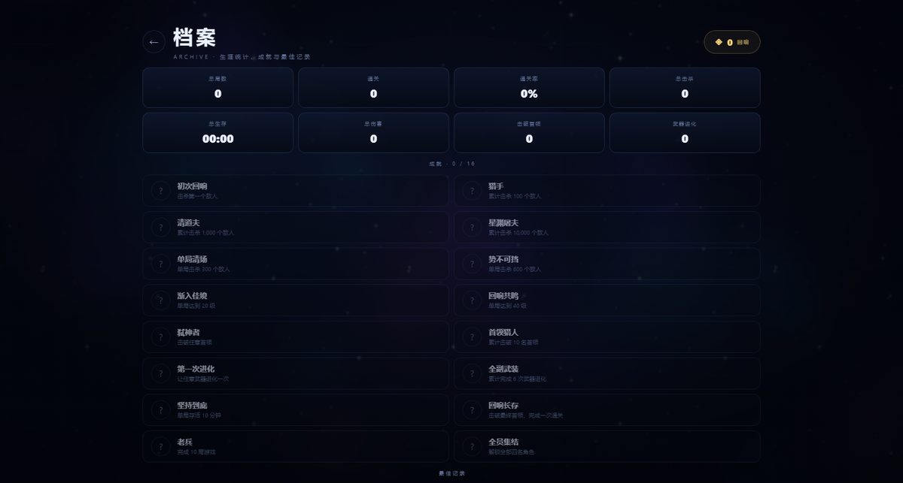 |

| 设置 | 强化 |
|---|---|
| 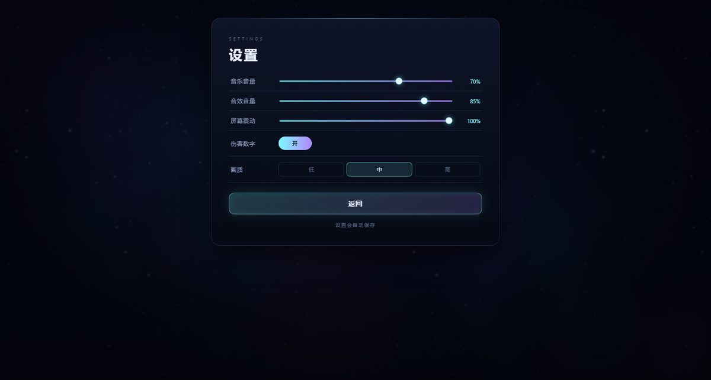 | 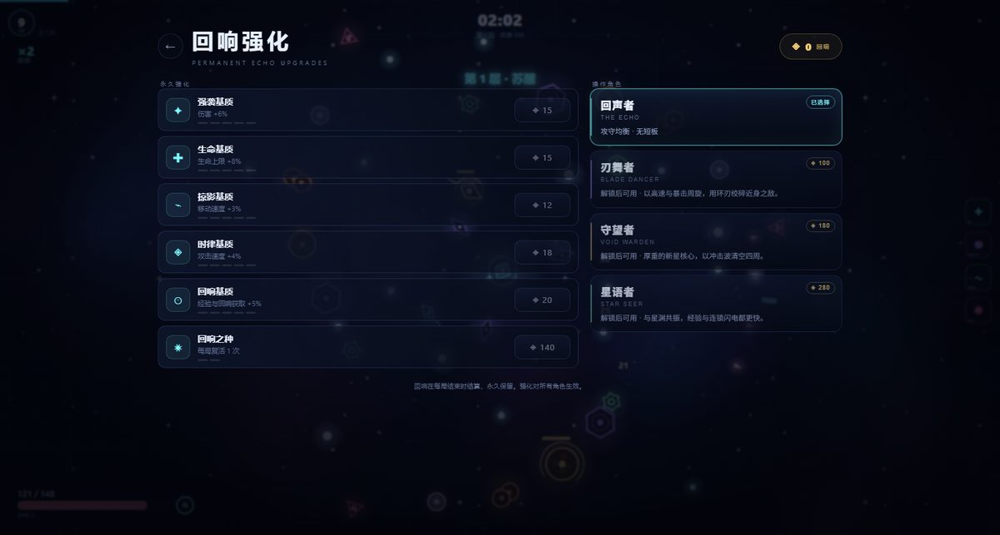 |

| 每日挑战 |
|---|
| 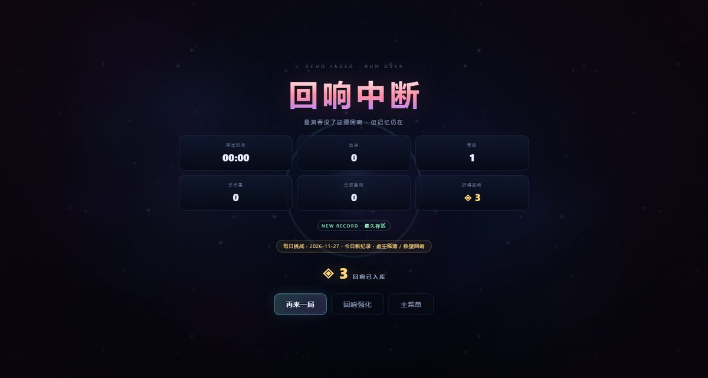 |

| 新首领「星蚀」 | 首领登场演出 |
|---|---|
| 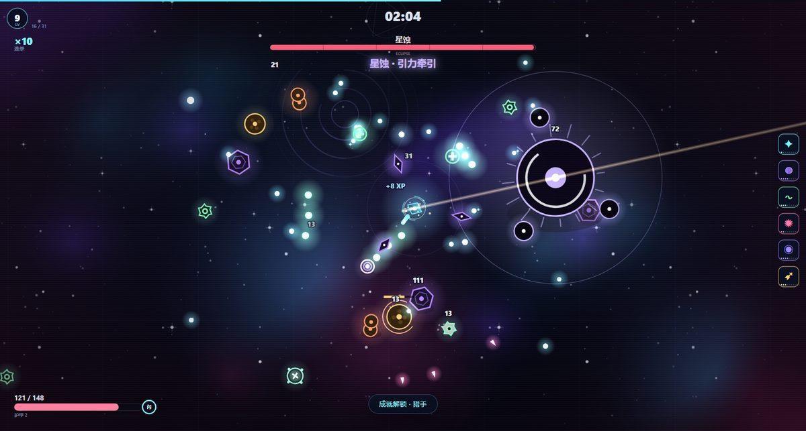 |  |

| 手机竖屏菜单 | 手机竖屏战斗 |
|---|---|
| 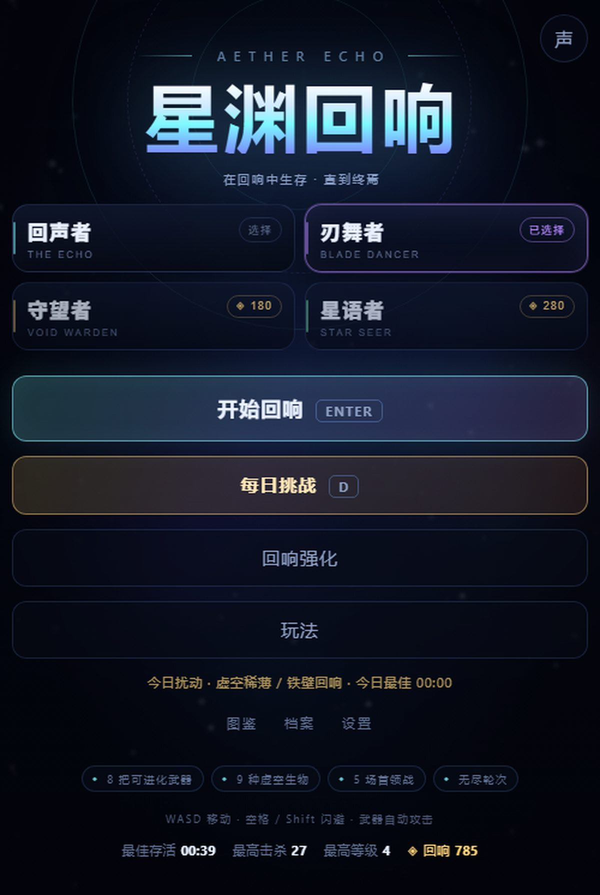 | 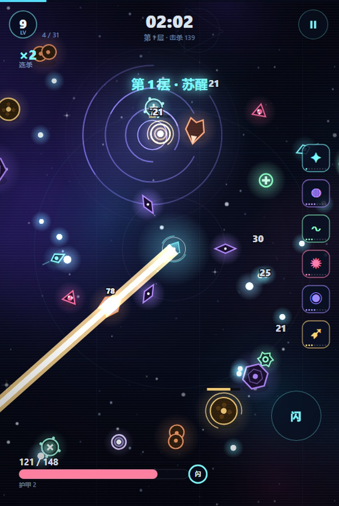 |

| 首领连战 |
|---|
| 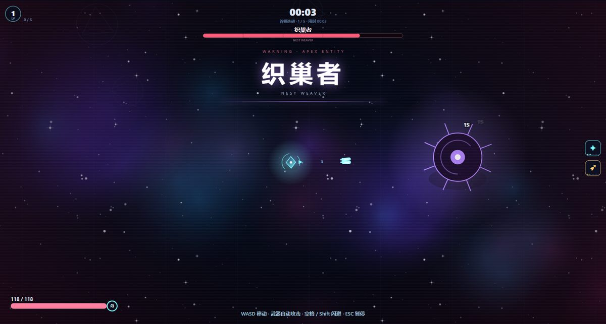 |

| 遗物三选一 |
|---|
| 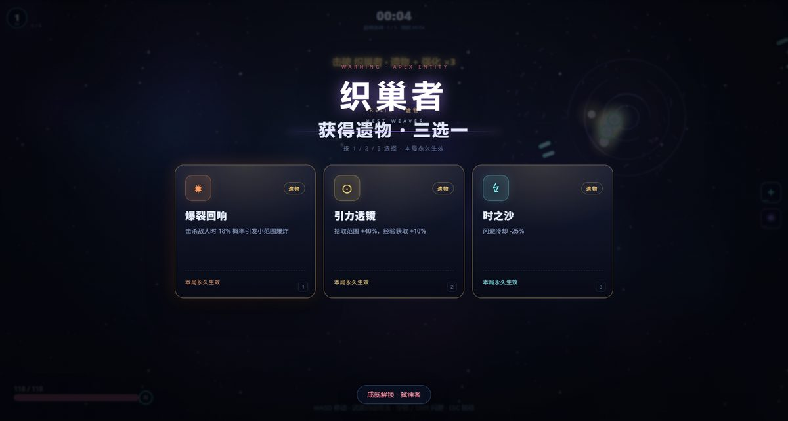 |

---

## 版本记录

- **1.7.0** — 新增遗物系统：14 件遗物（暴击连锁、击杀爆炸、冻结、吸血等），每次击破首领后三选一；暂停界面显示已获遗物，图鉴新增遗物页；UI 冒烟测试扩到 51 项。
- **1.6.0** — 新增「首领连战（Boss Rush）」模式：五名首领连续挑战、每场 3 次强化、按用时排行；菜单 / 结算 / 档案新增连战最佳；UI 冒烟测试扩到 50 项。
- **1.5.0** — 移动端与可访问性：手机竖屏/横屏布局、安全区适配、触屏暂停键、低动态模式、高对比模式、低画质省略星云与扫描线、掉帧自动降画质；UI 冒烟测试扩到 46 项。
- **1.4.0** — 新增无尽专属首领「星蚀」：三颗环绕黑星、引力牵引、三道旋转激光、50% 狂暴；新增首领登场 WARNING 演出卡；UI 冒烟测试扩到 44 项。
- **1.3.0** — 新增每日挑战：日期种子固定刷怪序列 + 两条随机扰动 + 每日最佳记录；菜单 / 暂停 / 结算 / 档案均显示每日信息；UI 冒烟测试扩到 43 项。
- **1.2.0** — 新增两把武器「引力奇点 / 贯穿光矛」与进化「事件视界 / 贯穿星轨」；新增两种敌人「织命者（治疗友军）」与「冲角兽（预警冲锋）」；武器位仍为 6，8 把武器需要取舍。
- **1.1.0** — 新增设置（音量 / 震动 / 伤害数字 / 画质）、图鉴、档案（生涯统计 + 16 项成就 + 本地最佳记录）；BOSS 击破慢镜头、升级镜头脉冲；UI 冒烟测试扩到 36 项。
- **1.0.0** — 首个完整版本：6 武器进化、10 被动、7 敌人、4 BOSS、4 角色、局外强化、无尽轮次。

---

## 小贴士

- 前期优先把**一把武器升到 8 级**触发进化，收益远大于平均分配。
- 「引力拾取」与「自愈回响」是开荒期最舒服的两个被动。
- 闪避有无敌帧，可以穿过弹幕与敌群。
- BOSS 放大招前都有明显前摇，提前绕开。
- 每局结束都能拿到回响，先买「生命基质 / 回响基质」更稳。
- 看到绿色的「织命者」优先点掉，它会持续治疗周围的敌群。
- 橙色「冲角兽」冲锋前有虚线预警，横向走位即可躲开。

---

*版本 1.7.0 · 无外部素材 · 无第三方依赖*
